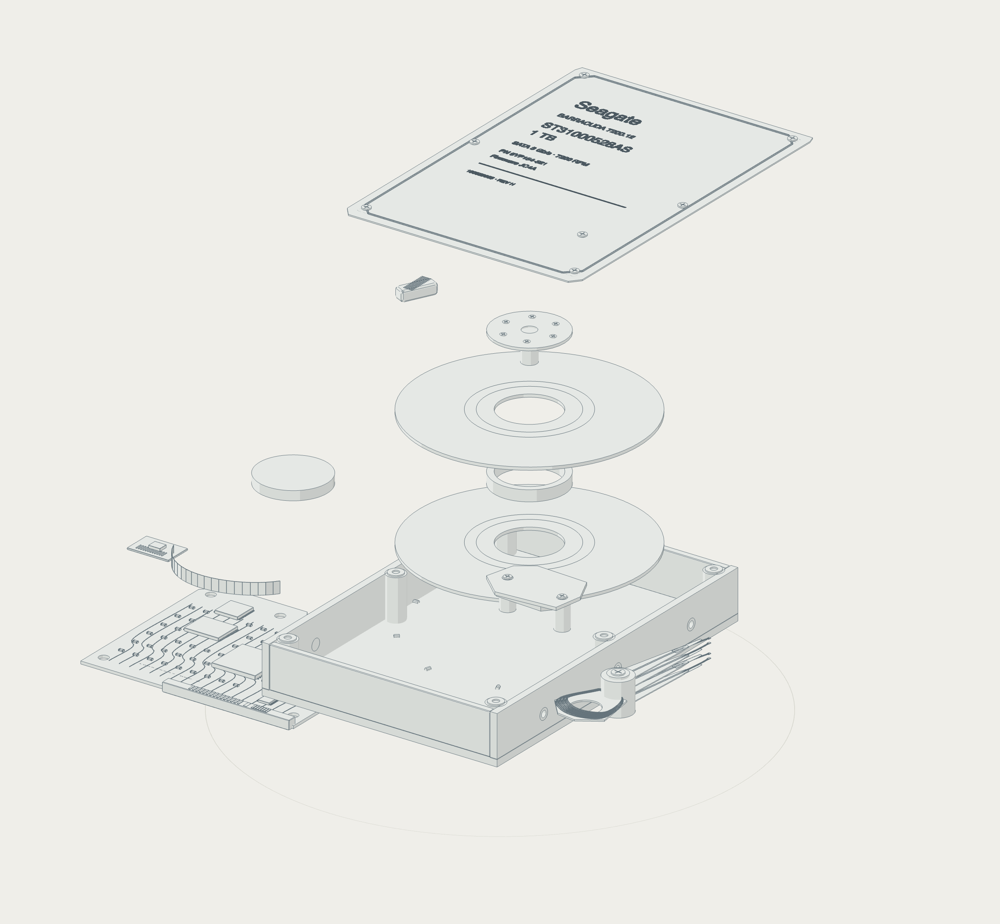

# breakboard

An interactive 3D collection of electronic devices and parts. Explore development boards, chips, sensors, displays, lenses, storage and mechanisms—assembled, exploded or in X-ray view.

[Open breakboard](https://breakboard-teardown.vercel.app) · [Download the offline version](https://breakboard-teardown.vercel.app/breakboard.html)

Built with Three.js, vanilla JavaScript and Vite. Runs in the browser with no account, API key or backend.

## Run locally

Requires Node.js **22.12+** (or **20.19+ on the 20.x line**) and a browser with WebGL 2 enabled.

```sh
git clone https://github.com/hckmstrrahul/breakboard.git
cd breakboard
npm ci
npm run dev
```

Open the local URL printed by Vite.

## Explore

- **Choose a device** from the category tabs, or use the grid button to browse the collection. Adjust grid density; hover a model to rotate and explode it, then click to open its full view. On touch screens, tap to open.
- **Take it apart** with Assembled, Exploded and the Separation slider. Use the previous and next arrows to move within a category.
- **Inspect components** by selecting them in the model or component list. Other parts fade; Isolate hides them. Labels and X-ray reveal the assembly's structure.
- **See it work** with Play and each device's controls. Rotate enables a turntable view; 3D, Top and Front change the camera.
- **Make it your own** with light, dark or system appearance. Save image exports a PNG of the model.

## Light-mode gallery

Actual model exports, shown with materials and in X-ray view.

| Device | Materials | X-ray |
| --- | --- | --- |
| **Raspberry Pi 5** |  |  |
| **Nixie tube** |  |  |
| **Barracuda HDD** |  |  |

[Browse all device images](docs/images/) · [Device catalogue](src/boards.js)

## Take it offline

<!-- offline-stats:start -->
**65 interactive devices in one 38.28 MB HTML file** (36.50 MiB).
<!-- offline-stats:end -->

Download [breakboard.html](https://breakboard-teardown.vercel.app/breakboard.html) and open it in a WebGL 2 browser. Models, fonts, controls and image export are included; no server or internet connection is needed.

## Build

```sh
npm run build
```

Deploy `dist/` to a static host, or share `dist/breakboard.html` as a standalone file.

## Accuracy and sources

Models use documented hardware revisions, manufacturer drawings, CAD and photographs where available. Open **Model notes** in the viewer for each device's sources and reconstruction limits; supporting records are in [reference/](reference/).

Hidden chip layouts, MEMS structures and other unpublished internals are identified as representative cutaways. Exploded views explain construction rather than prescribe disassembly. Animations illustrate operating principles; they are not circuit or engineering simulations.

## Design references

The viewer draws on [Jakub Krehel's Teardown skill](https://github.com/jakubkrehel/skills/blob/main/skills/teardown/SKILL.md), [Anatomy by wheresryan22](https://github.com/wheresryan22/anatomy), [Elvar's Teardown skill](https://github.com/elvarofficial/teardown/blob/main/SKILL.md) and [Untitled UI](https://www.untitledui.com/react/integrations/mcp). These provided design guidance; the application uses a custom Three.js renderer.

## Attribution

- Raspberry Pi CAD © 2026 Raspberry Pi Ltd, [MIT](public/licenses/raspberry-pi-cad-MIT.txt). Adaptations: tessellation, coordinates, grouping and materials.
- Arduino Uno/Nano layouts and adapted geometry retain [CC BY-SA 4.0](https://creativecommons.org/licenses/by-sa/4.0/). Adaptations: layout extraction, package reconstruction and materials; [source notice](public/licenses/arduino-cad-CC-BY-SA-4.0.txt).
- BeagleBoard documentation/imagery © BeagleBoard.org Foundation, CC BY-SA 4.0; reconstructed BeagleBone geometry is offered under the same license. NVIDIA reference geometry remains subject to its download terms. Per-board records in [reference/](reference/) link original sources.
- Adafruit NeoMatrix layout and adapted geometry: [CC BY-SA 3.0](https://creativecommons.org/licenses/by-sa/3.0/); [source](https://github.com/adafruit/Adafruit-NeoPixel-8x8-Matrix). HackRF r10 hardware and adapted geometry: [CERN-OHL-P-2.0](https://ohwr.org/cern_ohl_p_v2.txt); [source](https://github.com/greatscottgadgets/hackrf/tree/main/hardware/hackrf-one). Portenta geometry is derived from Arduino’s published reference STEP; see [evidence](reference/portenta/evidence.md).
- NE555 genuine die photograph © Mikhail Svarichevsky / ZeptoBars, [CC BY 3.0](public/licenses/ne555-zeptobars.txt); cropped, resampled and rendered in color or monochrome.
- [Untitled UI icon notice](public/licenses/untitled-ui-icons.txt). Board names and logos identify their respective hardware vendors.
