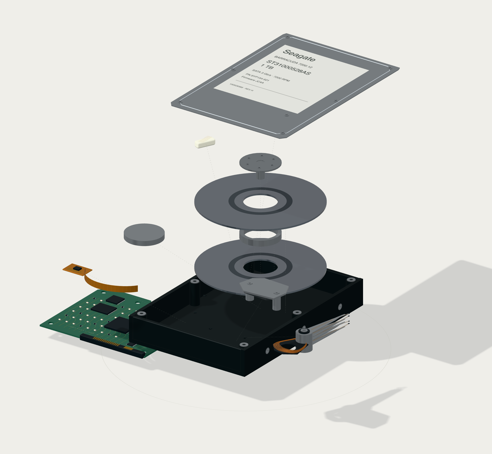
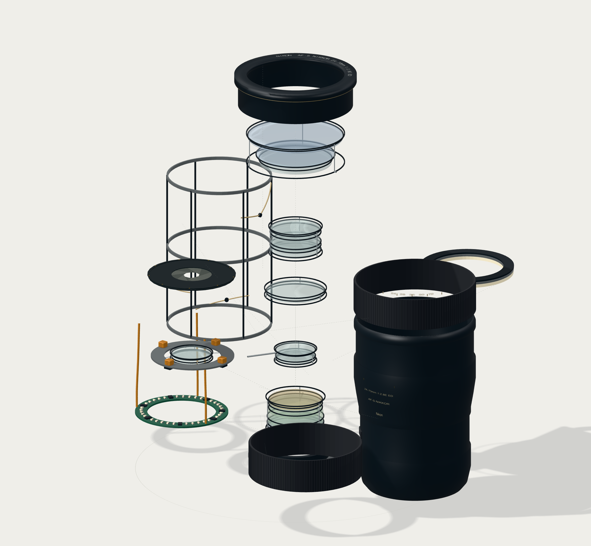
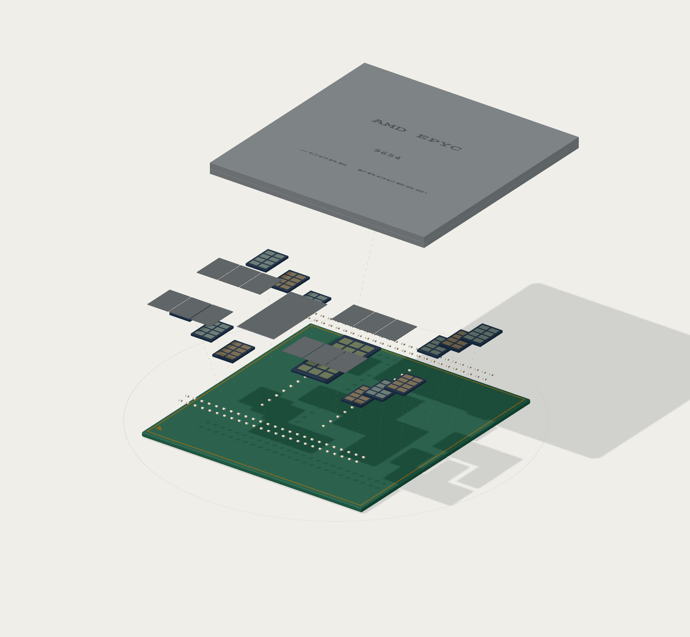
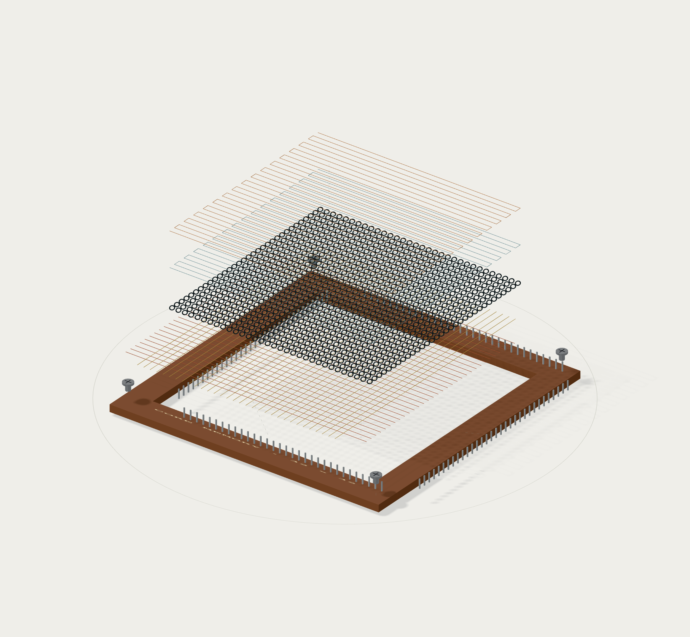

<div align="center">


# breakboard

Explore electronics in 3D, from assembled devices to individual components.

[](https://github.com/hckmstrrahul/breakboard/stargazers)

[Open the app](https://breakboard-teardown.vercel.app) · [Download for offline use](https://breakboard-teardown.vercel.app/breakboard.html)

</div>

Breakboard is an interactive collection of development boards, chips, sensors, displays, lenses, storage and mechanisms. Take models apart, inspect their components, and explore how they work through animations and device controls.

Built with Three.js, vanilla JavaScript and Vite. No account, API key or backend required.

## Light-mode gallery

Eight devices from the collection, shown with materials or in X-ray view. Open any image for the full-size export.

| Raspberry Pi 5 · Materials | ESP32 · X-ray |
| --- | --- |
|  |  |
| **Hard disk · Materials** | **Zoom lens · Materials** |
|  |  |
| **Nixie tube · X-ray** | **Stepper motor · X-ray** |
|  |  |
| **AMD EPYC 9654 · Materials** | **Core memory · Materials** |
|  |  |

[Browse images of all 65 devices](docs/images/)

## Quick start

To run locally, use Node.js **22.12+** (or **20.19+ on the 20.x line**) and a browser with WebGL 2 enabled.

```sh
git clone https://github.com/hckmstrrahul/breakboard.git
cd breakboard
npm ci
npm run dev
```

Open the local URL printed by Vite. No environment variables or additional configuration are needed.

## Explore

- **Browse:** choose a device from the category tabs, or open the grid and adjust its density. Hover to rotate and explode a model; click or tap to open it.
- **Take apart:** switch between Assembled and Exploded, or adjust Separation. The arrows move between devices in the same category.
- **Inspect:** select a component to read its details and fade the surrounding parts. Use Isolate, Labels and X-ray to see the structure.
- **Play:** animate the device and try its controls. Rotate enables a turntable; 3D, Top and Front change the camera.
- **Save:** export a PNG from the device viewer. Light is the default appearance; Dark and System are available, and your choice is remembered.

## Take it offline

<!-- offline-stats:start -->
**65 interactive devices in one 38.28 MB HTML file** (36.50 MiB).
<!-- offline-stats:end -->

Download [breakboard.html](https://breakboard-teardown.vercel.app/breakboard.html) and open it in a WebGL 2 browser. Models, fonts, controls and image export are included; no server or internet connection is needed.

## Build

```sh
npm run build
```

Deploy `dist/` to a static host, or share `dist/breakboard.html` as a standalone file.

## Project structure

```text
breakboard/
├── docs/         # Guides and model images
├── public/       # Runtime CAD assets and source licenses
├── reference/    # Hardware evidence and reconstruction notes
├── scripts/      # Build, asset-generation and validation tools
├── src/          # Models, renderer and interface
├── index.html    # Application entry page
└── package.json  # Dependencies and commands
```

## Documentation

| Resource | Contents |
| --- | --- |
| [Device catalogue](src/boards.js) | Registered models and their metadata |
| [Hardware references](reference/) | Sources, revisions and reconstruction evidence |
| [Grid guide](docs/infinite-grid.md) | Collection browsing, previews and rendering |
| [Image gallery](docs/images/) | Material and X-ray exports for every device |

## Accuracy and sources

Models use documented hardware revisions, manufacturer drawings, CAD and photographs where available. Open **Model notes** in the viewer for each device's sources and reconstruction limits.

Hidden chip layouts, MEMS structures and other unpublished internals are identified as representative cutaways. Exploded views explain construction rather than prescribe disassembly. Animations illustrate operating principles; they are not circuit or engineering simulations.

## Skills and design references

Agent skills used for illustration guidance and documentation:

| Name | Description | Repository |
| --- | --- | --- |
| Teardown · Jakub Krehel | Technical illustrations that explain physical objects and how their parts work together. | [jakubkrehel/skills](https://github.com/jakubkrehel/skills/tree/main/skills/teardown) |
| Anatomy · wheresryan22 | Detailed, interactive isometric illustrations of machines and complex systems. | [wheresryan22/anatomy](https://github.com/wheresryan22/anatomy) |
| Teardown · Elvar | Guidance for exploded views and component-level technical illustrations. | [elvarofficial/teardown](https://github.com/elvarofficial/teardown) |
| README Wizard · Debbie O'Brien | Project-aware README structure, verified setup instructions and visual presentation. | [debs-obrien/learn-agent-skills](https://github.com/debs-obrien/learn-agent-skills/tree/main/.agents/skills/readme-wizard) |

[Untitled UI](https://www.untitledui.com/react/integrations/mcp) also informed the interface. The application uses a custom Three.js renderer.

## Attribution

- Raspberry Pi CAD © 2026 Raspberry Pi Ltd, [MIT](public/licenses/raspberry-pi-cad-MIT.txt). Adaptations: tessellation, coordinates, grouping and materials.
- Arduino Uno/Nano layouts and adapted geometry retain [CC BY-SA 4.0](https://creativecommons.org/licenses/by-sa/4.0/). Adaptations: layout extraction, package reconstruction and materials; [source notice](public/licenses/arduino-cad-CC-BY-SA-4.0.txt).
- BeagleBoard documentation/imagery © BeagleBoard.org Foundation, CC BY-SA 4.0; reconstructed BeagleBone geometry is offered under the same license. NVIDIA reference geometry remains subject to its download terms. Per-board records in [reference/](reference/) link original sources.
- Adafruit NeoMatrix layout and adapted geometry: [CC BY-SA 3.0](https://creativecommons.org/licenses/by-sa/3.0/); [source](https://github.com/adafruit/Adafruit-NeoPixel-8x8-Matrix). HackRF r10 hardware and adapted geometry: [CERN-OHL-P-2.0](https://ohwr.org/cern_ohl_p_v2.txt); [source](https://github.com/greatscottgadgets/hackrf/tree/main/hardware/hackrf-one). Portenta geometry is derived from Arduino’s published reference STEP; see [evidence](reference/portenta/evidence.md).
- NE555 genuine die photograph © Mikhail Svarichevsky / ZeptoBars, [CC BY 3.0](public/licenses/ne555-zeptobars.txt); cropped, resampled and rendered in color or monochrome.
- [Untitled UI icon notice](public/licenses/untitled-ui-icons.txt). Board names and logos identify their respective hardware vendors.
